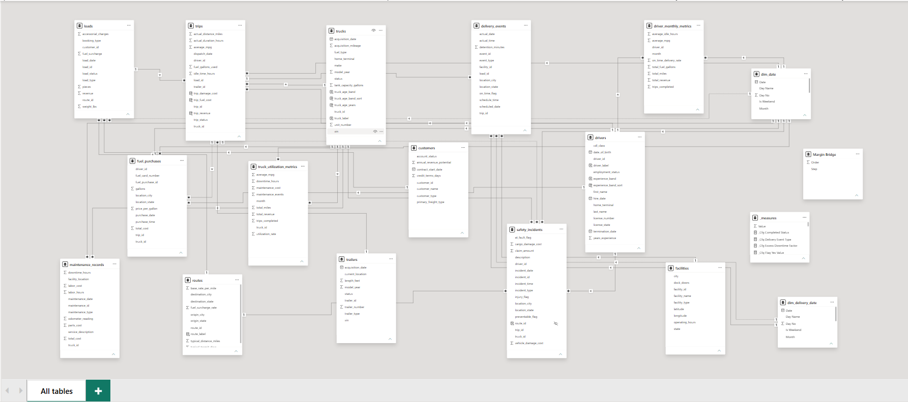
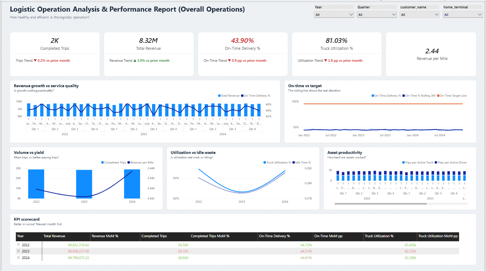
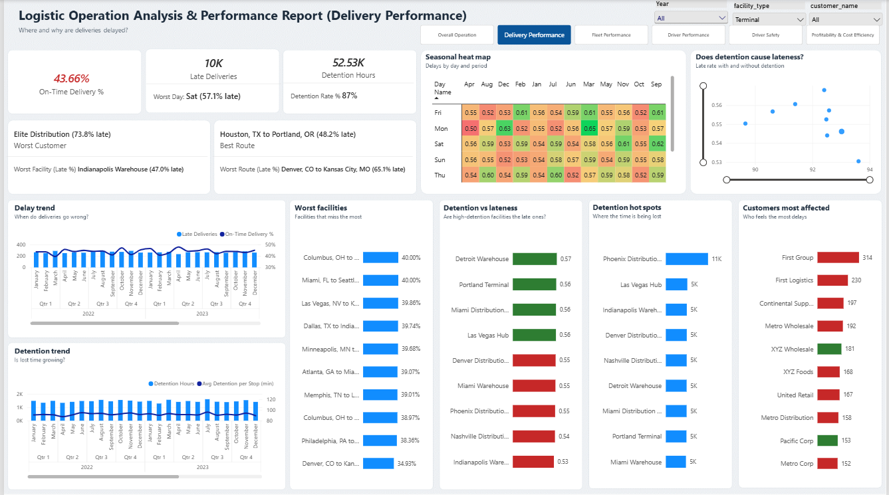
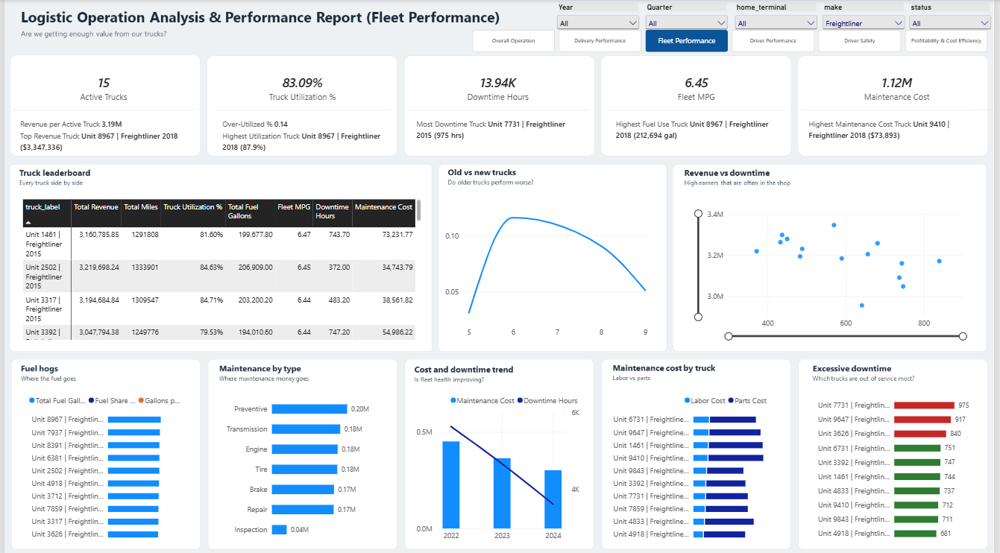
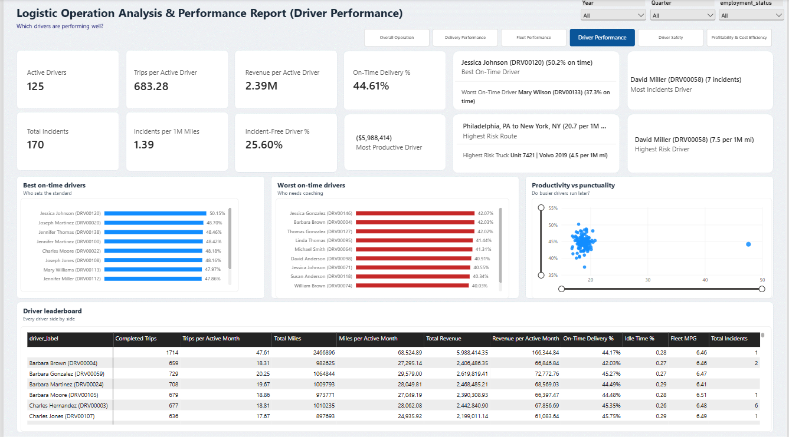
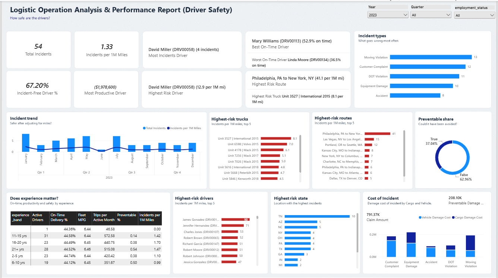
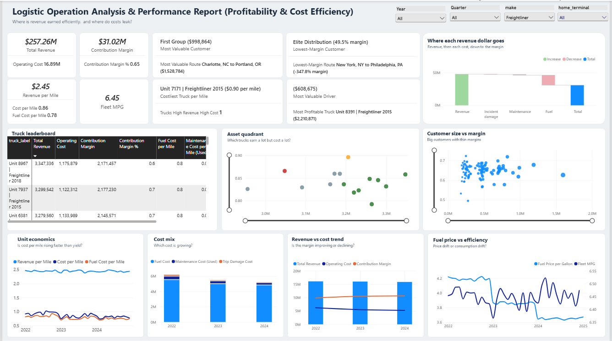

# Logistic-Operations-and-Report-Analysis

- [Question](#Questions)
- [Processing](#Processing)
- [Methodology](#Methodology)
- [Visualization](#Visualization)
- [Insights](#Insights)
- [Recommendations](#Recommendations)
- [Tools](#Tools)

## Question

## Processing

## Methodology

## Visualization

**Overall Operations**

**Delivery Perdormance**

**Fleet Perdormance**

**Driver Safety**

**Driver Perdormance**

**Profitability & Cost Efficiency**

## Insights

## Recommendations

## Tools

| Tools | Purpose |
| --- | --- |
| Power BI | Data Modeling, DAX measures, Visualization |

